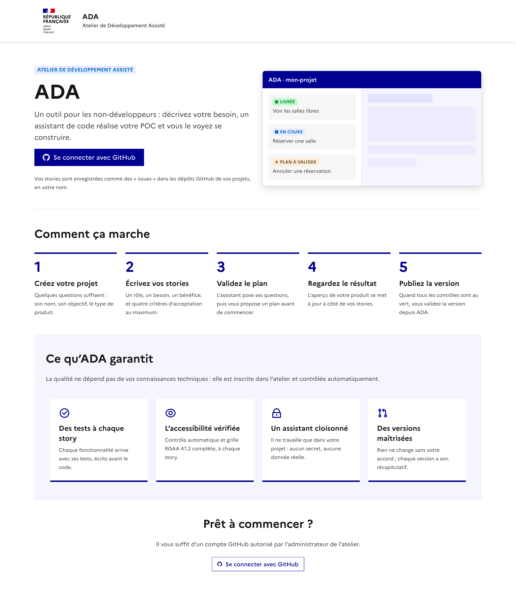
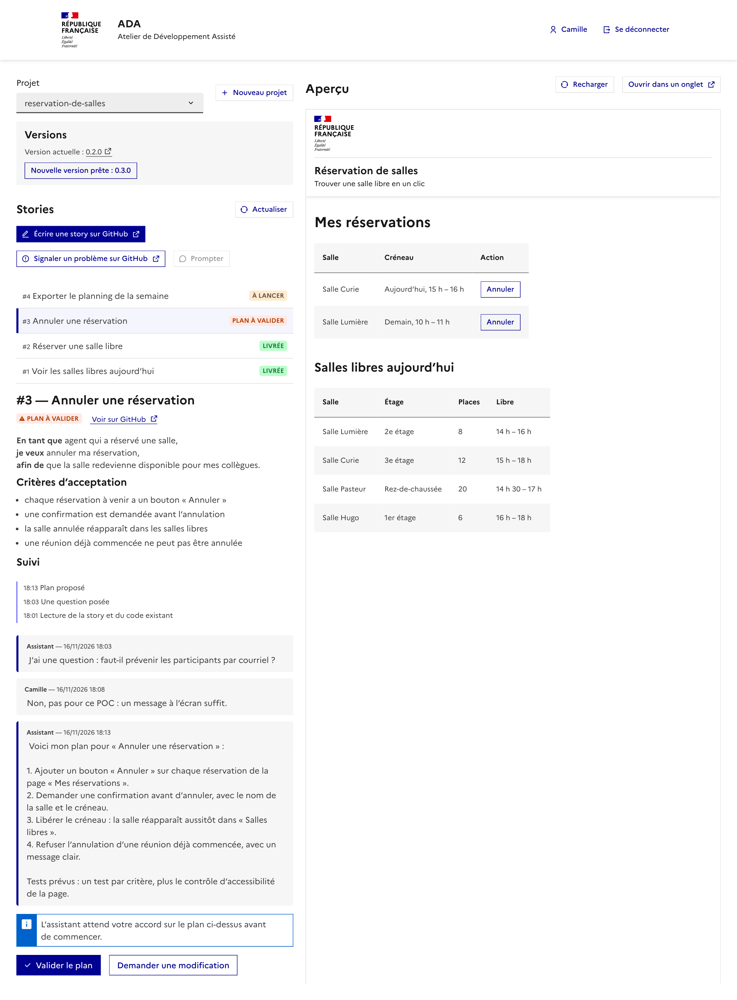

# ADA — Atelier de Développement Assisté


> [!IMPORTANT]
> **ADA n'est pas un outil officiel.** C'est un POC réalisé à l'initiative du propriétaire de ce
> dépôt.

**Une interface de développement no-code.** ADA permet à des personnes qui ne codent pas de
réaliser leurs POC avec un assistant de code. Elles créent un projet, décrivent leurs besoins
sous forme de user stories ou signalent des problèmes. L'assistant pose ses questions, fait
valider un plan, code avec tests et contrôle d'accessibilité, puis livre une pull request.
Elle est fusionnée quand la CI est verte.

## Aperçu

*Captures réalisées avec des données de démonstration.*

**Accueil** : ce qu'est ADA, et la connexion avec GitHub.



**L'atelier** : les stories à gauche, l'aperçu du produit à droite. Ici, l'assistant a posé
une question, obtenu la réponse, et attend qu'on valide son plan.



**La vérification** : la story est réalisée, tous les contrôles sont réussis ; il reste à
regarder le résultat dans l'aperçu et à valider.


**Nouveau projet** : un nom, votre idée racontée librement, et le type de produit à créer.


Skills au format ouvert [Agent Skills](https://agentskills.io) : Claude Code, Codex, OpenCode,
Cursor, Copilot, Gemini CLI. ADA relie à chaque projet les skills de
[IA-Generative/agent-skills](https://github.com/IA-Generative/agent-skills) et de la DINUM
(`dsfr-skill`) pour que son agent puisse les lire, et ajoute 3 skills qui lui sont propres (voir
ci-dessous), écrites selon les mêmes conventions qu'agent-skills. Ces 3 skills guident un agent
piloté par une personne, dans ADA ou dans un projet créé par elle ; l'agent de l'interface suit,
lui, des consignes écrites dans le code (`interface/api/src/agent/consignes.ts`).

> 🤖 Vous êtes un agent de codage ? Lisez [`AGENTS.md`](AGENTS.md).

## Skills

| Skill | Ce qu'elle fait |
|---|---|
| `po-projet-nouveau` | Nom → objectif → stack (6 autorisées) → DSFR → squelette testé, CI, anti-fuite gitleaks, release-please, ADR-0001, modèles d'issues et de PR, route `/__version__` |
| `po-story` | Story complète et courte (4 critères au maximum) → plan validé → tests d'abord → RGAA (axe-core + grille) → contrôle de périmètre → fiche de relecture → PR |
| `po-bug` | Constat → 2-3 hypothèses → test rouge → correction minimale → fiche → PR |

Toutes trois ont un effet de bord : elles ne se lancent que **sur demande explicite**.

## Ce que chaque projet reçoit dès sa création

| Élément | Rôle |
|---|---|
| CI (`ci.yml`) : anti-fuite, lint, types, tests (dont accessibilité), compilation | Vérifie automatiquement chaque changement |
| gitleaks (pre-commit + CI), `.gitignore` durci, `private/` | Aucun secret, aucune donnée réelle |
| release-please | Versions et journal des changements automatiques |
| `AGENTS.md` (+ `CLAUDE.md` qui l'importe) | Le projet fonctionne avec n'importe quel agent |
| ADR-0001 « Choix de la stack » | Garde la trace des choix techniques |
| Modèles d'issues (story, bug) et de PR | Même format que l'interface web |
| `GET /__version__` (contrat `repo-version-json`) | Savoir quelle version tourne |
| Formulaires de story et de signalement, contrôle du titre des PR | Les demandes s'écrivent au même format, les versions se calculent seules |
| Contrôle « Taille des fichiers » (`taille-fichiers.yml`) | Un fichier, une responsabilité : 400 lignes non vides au plus (600 pour un test) |
| Protection de `main` (posée par l'interface web) | Rien n'entre sans PR ni contrôles verts |

## Utiliser

**Avec VS Code** : ouvrir `ada.code-workspace`, puis dans le panneau de l'assistant :
`/po-projet-nouveau`, `/po-story …`, `/po-bug …`. Guide d'utilisation : [GUIDE-PO.md](GUIDE-PO.md).

**Avec l'interface web** (`interface/`, dans ce dépôt) : connexion GitHub, stories et
signalements à gauche, aperçu du produit à droite. **Installer et lancer ADA pas à pas :**
[interface/README.md](interface/README.md#installer-et-lancer-ada-pas-à-pas).

**Ailleurs** : les skills sont dans `skills/po/` ; des liens les exposent dans `.claude/skills/`
et `.agents/skills/`. Pour les installer pour tous ses projets : lier chaque dossier de
`skills/po/` dans `~/.claude/skills/` ou `~/.agents/skills/` (un lien par skill, jamais le
dossier parent).

## Garde-fous de l'atelier (Claude Code)

`.claude/settings.json` : hook `destructive-guard` (repris d'agent-skills) qui bloque
`git reset --hard`, `push --force`, `--no-verify`, `DROP TABLE`, `docker volume prune`… ;
permissions limitées ; lecture des `.env` interdite. Les autres agents ont leurs propres
mécanismes : la CI et la protection de `main` restent le vrai filet.

## Contribuer

[CONTRIBUTING.md](CONTRIBUTING.md). Vérifications :
```bash
node scripts/verifier-skills.mjs
node scripts/skills-index.mjs --check
```
Après un changement de consigne de l'agent, de modèle ou de skill : banc d'essai,
[scripts/banc-agent/README.md](scripts/banc-agent/README.md) (il consomme des appels à l'agent : pas dans la CI).

## Sources

[docs/sources-externes.md](docs/sources-externes.md).
